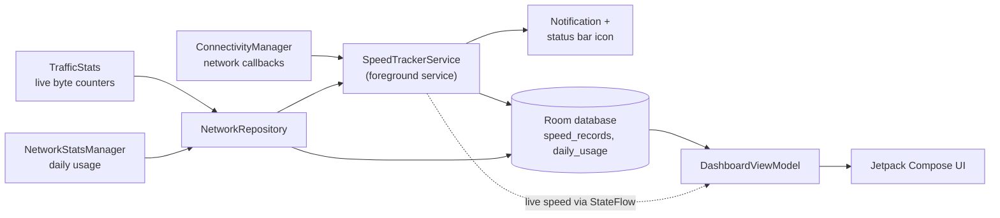

<div align="center">

# 📶 NetPulse

### Live internet speed in your status bar, and a clear picture of your data usage.

A fast, private, offline-first Android app that shows your real-time download and upload speed in the status bar and notification shade, then keeps a 90-day history of your Wi-Fi and mobile data usage.

[](https://github.com/ayushgohil/Internet-Speed-Tracker-App/actions/workflows/build-apk.yml)


[Features](#-features) · [How it works](#-how-it-works) · [Get the APK](#-get-the-apk) · [Build from source](#-build-from-source) · [Troubleshooting](#-troubleshooting)

</div>

---

## 📖 Table of contents

- [Overview](#-overview)
- [Features](#-features)
- [Design preview](#-design-preview)
- [How it works](#-how-it-works)
- [Staying alive in the background](#-staying-alive-in-the-background)
- [Settings reference](#-settings-reference)
- [Permissions](#-permissions)
- [Tech stack](#-tech-stack)
- [Project structure](#-project-structure)
- [Get the APK](#-get-the-apk)
- [Build from source](#-build-from-source)
- [Continuous integration](#-continuous-integration)
- [Testing](#-testing)
- [Troubleshooting](#-troubleshooting)
- [Privacy](#-privacy)
- [Author & license](#-author--license)

---

## ✨ Overview

NetPulse is a lightweight network monitor built with **Kotlin** and **Jetpack Compose**. It answers two everyday questions:

1. **"How fast is my connection right now?"** A live download and upload speed, always visible in the status bar and the notification shade, even when the app is closed.
2. **"How much data have I used?"** Daily Wi-Fi and mobile totals for today, plus a 90-day activity heatmap and a day-by-day table.

Everything is computed on your device. There is no account, no server, and no analytics (see [Privacy](#-privacy)).

---

## 🚀 Features

### ⚡ Live speed, everywhere you look
- **Status bar speed icon:** an optional icon that shows your current download speed as a large two-row number (`84` over `KB/s`), drawn with a condensed bold font so it stays readable at status bar size.
- **Ongoing notification** with live download ↑ and upload ↓ speed and today's mobile and Wi-Fi usage.
  - **Minimal:** a compact two-line view.
  - **Detailed:** an expanded card with today's mobile, Wi-Fi and total usage, the connection type, and a **Stop** action.
- **Choose your units:** Automatic (adaptive), always KB/s, or always MB/s.
- **Refresh rate:** 1 second (interactive) or 2.5 seconds (battery saver).

### 📊 Usage history
- **Today's consumption** for mobile data and Wi-Fi, counted since 12:00 AM local time.
- **90-day activity heatmap:** each day is coloured by how much data you used, using quantile-based intensity levels so it adapts to your own habits. Days with no record and days with exactly zero usage are shown differently.
- **Tap any day** for a detailed breakdown of mobile, Wi-Fi and the combined total.
- **Daily table** with date, mobile, Wi-Fi and total columns, plus a sticky 90-day summary bar.
- **History reconciliation:** re-syncs the past 90 days from Android's own network statistics, and never overwrites a larger known value with a temporary zero.

### 🧾 Speed logs
- Raw speed samples are stored locally so you can review them later.
- Filter by **All**, **Wi-Fi** or **Mobile**. Each entry shows the date, connection type, download and upload speed.
- Smart storage: nothing is written while offline, idle zero-speed is stored once instead of every second, and samples while the screen is off are kept only for substantial transfers.
- Choose how long to keep logs (**7, 30 or 90 days**). A daily cleanup job enforces it, and **Clear logs** never touches your daily usage history.

### 🛡️ Built to keep running
- Runs as a **foreground service** so Android treats it as an active, user-visible task.
- Multiple safety nets bring it back after a reboot, an app update, a swipe from recents, or a night offline (see [Staying alive in the background](#-staying-alive-in-the-background)).
- A built-in **Diagnostics** screen shows service state, why Android last ended the process, and a log of recent restart attempts.

### 🎨 Look & feel
- Material 3 interface with **Dark** (Midnight Blueberry), **Light** (Blueberry + Cream Soda) and **Follow system** themes.
- A guided **Permissions & Battery** panel that shows exactly what is missing and takes you straight to the right system screen.

---

## 🖼️ Design preview

The wireframe below is the design reference the interface was built from. The shipped app differs slightly: it has **two tabs (Overview and Usage)**, and Speed Logs and Diagnostics are reached from **Settings**.

<div align="center">


</div>

---

## 🧠 How it works

NetPulse uses two different Android data sources, each for what it does best:

| Need | Source | Why |
|------|--------|-----|
| Live speed (updates every second) | `TrafficStats` byte counters | Cheap to read, no special permission. Speed is the change in bytes divided by the elapsed time. |
| Daily and historical usage | `NetworkStatsManager` | Android's own per-day statistics for Wi-Fi and mobile data. Needs the **Usage Access** permission. |
| Connection type and changes | `ConnectivityManager` network callbacks | Instantly reacts to Wi-Fi ↔ mobile ↔ offline switches. |



**Sampling cadence.** The service adapts to save battery:

| Situation | Sample interval |
|-----------|-----------------|
| Screen on | every 1 second |
| Screen off, online | every 5 seconds |
| Screen off, offline | every 10 seconds |

**Smoothing.** The dashboard averages the last three samples so the number doesn't jitter, resets immediately when you switch networks, and drops to zero after two consecutive idle readings instead of trailing off slowly.

**Storage.** A single Room database (`netpulse_database`) holds two tables: `speed_records` (raw samples) and `daily_usage` (one row per day). Lightweight settings and diagnostics live in SharedPreferences.

---

## 🔋 Staying alive in the background

Keeping a monitor running all night is the hardest part of an app like this, because Android (and many phone makers) aggressively stop background apps. NetPulse layers several safety nets:

| Safety net | What it does |
|-----------|--------------|
| **Foreground service** | Shows the live notification and tells Android the app is actively in use. Restarts automatically if the system recreates it (`START_STICKY`). |
| **Boot / app-update receiver** | Restores tracking after a reboot or an update, and re-registers the network wake-up below. |
| **Network wake-up callback** | A system-held network callback that fires even if the app process is gone, so tracking resumes the moment internet returns (for example in the morning after a night offline). |
| **Swipe-from-recents alarm** | If you remove the app from recents, an alarm brings the service back. |
| **15-minute watchdog** | A WorkManager job checks that the service is running and revives it if not. |
| **Backoff retries** | If Android refuses a background start, NetPulse retries after 15 s, 30 s, 60 s … up to 15 minutes instead of hammering the same restriction. |
| **Tap-to-resume notification** | If automatic restarts are blocked, a **"NetPulse is paused, tap to resume"** notification appears. A tap is always allowed to start the service. |
| **Restart log** | Settings → Diagnostics → *Recent restart attempts* records who tried to restart the service (boot, watchdog, network, etc.) and whether it worked. |

> 💡 **Important:** no app can override a phone's own battery manager. For the most reliable all-night tracking, set NetPulse to **Unrestricted** battery use (the dashboard's *Keep Active Overnight* card links straight to it), and on Xiaomi, Oppo, Vivo, OnePlus, Samsung and similar phones also allow **autostart / background activity** for NetPulse.

---

## ⚙️ Settings reference

| Section | Setting | Options |
|---------|---------|---------|
| **Appearance** | Theme | Dark (Midnight Blueberry) · Light (Blueberry + Cream Soda) · Follow system |
| **Monitoring** | Background monitoring | On / Off. Track speeds even when the app is closed |
| | Speed display units | Automatic (adaptive) · KB/s · MB/s |
| | Status-bar numeric speed *(experimental)* | On / Off. Show the live download rate as the status bar icon |
| | Notification style | Minimal (compact) · Detailed (expanded card with breakdown and Stop action) |
| | Notification refresh rate | 1 second (interactive) · 2.5 seconds (battery saver) |
| **Permissions & Battery** | Usage Access · Notifications · Battery Restrictions | Shows status and opens the right system screen |
| **History & Storage** | Speed log retention | 7 · 30 (default) · 90 days |
| | Clear speed logs | Deletes raw samples, keeps daily usage |
| | History reconciliation | Re-sync the past 90 days from system statistics |
| **Advanced** | Diagnostics & System Details | Service status, OS process exits, timestamps, restart attempts |
| | Speed Logs | Browse the raw speed samples |

---

## 🔐 Permissions

| Permission | Why NetPulse needs it |
|-----------|----------------------|
| `ACCESS_NETWORK_STATE` | Detect Wi-Fi, mobile or offline, and react to changes. |
| `PACKAGE_USAGE_STATS` (Usage Access) | Read Android's daily Wi-Fi and mobile data statistics. Granted by you in system settings. |
| `FOREGROUND_SERVICE` + `FOREGROUND_SERVICE_SPECIAL_USE` | Run the always-on speed monitor as a foreground service. |
| `POST_NOTIFICATIONS` | Show the live speed notification (Android 13+). |
| `RECEIVE_BOOT_COMPLETED` | Resume tracking after a reboot or app update. |
| `REQUEST_IGNORE_BATTERY_OPTIMIZATIONS` | Let you exempt NetPulse from battery optimization so it survives long idle periods. |
| `SCHEDULE_EXACT_ALARM` | Schedule precise restart alarms when Android allows it. |
| `INTERNET` | Declared, but NetPulse makes no network requests (see [Privacy](#-privacy)). |

---

## 🧰 Tech stack

| Area | Technology |
|------|-----------|
| Language | Kotlin 1.9.24 (JVM target 17) |
| UI | Jetpack Compose (BOM 2024.04.01), Material 3, Material Icons Extended |
| Architecture | Single-module app with ViewModel + UI state, repository, and a foreground service |
| Async | Kotlin Coroutines and Flow (1.8.0) |
| Persistence | Room 2.6.1 (with KSP), SharedPreferences |
| Background work | WorkManager 2.9.0, AlarmManager, foreground service |
| Build | Android Gradle Plugin 8.3.2, Gradle 8.5 (wrapper), KSP 1.9.24-1.0.20 |
| SDK levels | `minSdk` 26 (Android 8.0), `targetSdk` / `compileSdk` 34 (Android 14) |
| Testing | JUnit 4 |

---

## 🗂️ Project structure

```text
.
├── .github/workflows/build-apk.yml     # Builds the debug APK on every push
├── app/
│   ├── debug.keystore                  # Shared DEBUG signing key (debug builds only)
│   ├── build.gradle.kts
│   └── src/
│       ├── main/
│       │   ├── AndroidManifest.xml
│       │   └── java/com/ayush/netpulse/
│       │       ├── NetPulseApp.kt              # Application: wiring, workers, revival on process start
│       │       ├── data/
│       │       │   ├── local/                  # Room database, DAOs, entities
│       │       │   ├── model/                  # LiveSpeed, DataUsage, NetworkType, DiagnosticsInfo
│       │       │   └── repository/             # NetworkRepository (speed, usage, reconciliation)
│       │       ├── service/
│       │       │   ├── SpeedTrackerService.kt  # Foreground service: sampling + notification
│       │       │   ├── ServiceRevival.kt       # Network wake-up, backoff, tap-to-resume
│       │       │   ├── ServiceRestartReceiver.kt
│       │       │   └── BootReceiver.kt
│       │       ├── ui/
│       │       │   ├── MainActivity.kt / MainScreen.kt
│       │       │   ├── dashboard/              # Overview tab + ViewModel + UI state
│       │       │   ├── usage/                  # Heatmap, daily table, summary bar
│       │       │   ├── logs/                   # Speed logs list and filters
│       │       │   ├── settings/               # Settings, permissions, diagnostics
│       │       │   ├── navigation/ · theme/
│       │       ├── util/                       # SpeedIconGenerator, SpeedSmoother, NetworkUtils, PreferencesManager
│       │       └── worker/                     # LogRetentionWorker, ServiceWatchdogWorker
│       ├── test/                               # Unit tests
│       └── ui-images/                          # Design wireframe and reference images
├── build.gradle.kts · settings.gradle.kts · gradle.properties
└── gradlew · gradlew.bat · gradle/wrapper/
```

---

## 📲 Get the APK

You do **not** need Android Studio to get an installable app. GitHub builds it for you on every push.

1. Open the repository's **[Actions](https://github.com/ayushgohil/Internet-Speed-Tracker-App/actions)** tab.
2. Click the latest **Build debug APK** run (a green ✓ means the build worked).
3. Scroll to the **Artifacts** section at the bottom and download **`app-debug`**.
4. Unzip it, copy `app-debug.apk` to your phone and open it (allow *Install unknown apps* if asked).

Builds are signed with one shared debug key, so each new APK **installs over the previous one and keeps your data**. If you previously installed a build signed with a different key, uninstall it once first.

---

## 🛠️ Build from source

**Requirements**

- Android Studio (recent stable) or just a **JDK 17** and the Android SDK (platform 34)
- An Android 8.0+ device or emulator

**Steps**

```bash
git clone https://github.com/ayushgohil/Internet-Speed-Tracker-App.git
cd Internet-Speed-Tracker-App

# Build a debug APK
./gradlew assembleDebug          # Windows: gradlew.bat assembleDebug

# Install on a connected device
adb install -r app/build/outputs/apk/debug/app-debug.apk
```

The APK is written to `app/build/outputs/apk/debug/app-debug.apk`.

> ⚠️ **JDK path:** `gradle.properties` currently pins `org.gradle.java.home` to a Windows JDK 17 location. On another machine, change it to your own JDK 17 path or delete that line. (The GitHub workflow removes it automatically.)

---

## 🤖 Continuous integration

The workflow in [`.github/workflows/build-apk.yml`](.github/workflows/build-apk.yml) runs on every push and can also be started manually from the Actions tab (**Run workflow**). It:

1. Checks out the code and sets up JDK 17 and Gradle with caching.
2. Builds the debug APK with `./gradlew assembleDebug`.
3. Prints the APK's signing certificate, as a check that every build uses the same key.
4. Uploads `app-debug.apk` as the **`app-debug`** artifact, kept for 30 days.

> 🔑 **About the committed keystore:** `app/debug.keystore` is a **debug-only** key, committed on purpose so that every build shares a signature. Never use it to sign a release or Play Store build, and keep the repository private.

---

## 🧪 Testing

Unit tests cover the logic that is easy to get subtly wrong: speed formatting and units, speed smoothing, heatmap intensity levels, log retention, multi-day usage reconciliation, offline monitoring behaviour, and the diagnostics state.

```bash
./gradlew testDebugUnitTest
```

---

## 🩺 Troubleshooting

<details>
<summary><b>Tracking stops after a night offline, and I have to open the app to restart it</b></summary>

1. Set **Settings → Apps → NetPulse → Battery** to **Unrestricted** (or use the *Keep Active Overnight* card in the app).
2. On Xiaomi, Oppo, Vivo, OnePlus, Samsung and similar phones, also allow **autostart / background activity** and make sure NetPulse is not in a "sleeping apps" list.
3. If a **"NetPulse is paused"** notification appears, tap it to resume instantly.
4. Open **Settings → Diagnostics & System Details** and check *Recent restart attempts* and *Confirmed OS Exit Reason* to see what happened.

</details>

<details>
<summary><b>The usage numbers or heatmap are empty</b></summary>

Daily usage needs the **Usage Access** permission. Open **Settings → Permissions & Battery → Usage Access → Grant**, enable NetPulse in the system screen, then use **History reconciliation** to re-sync the past 90 days.

</details>

<details>
<summary><b>There is no speed notification</b></summary>

Allow **Notifications** for NetPulse (Android 13+ asks at first start) and make sure the **NetPulse Speed Monitor** channel is not silenced or blocked in the system settings. Also check that **Background monitoring** is switched on.

</details>

<details>
<summary><b>"App not installed" when updating from an APK</b></summary>

The installed copy was signed with a different key (for example, an older build). Uninstall NetPulse once and install the new APK. After that, updates install over the top.

</details>

<details>
<summary><b>The build fails with an invalid <code>org.gradle.java.home</code></b></summary>

`gradle.properties` points to a Windows JDK path. Edit it to your JDK 17 location or remove that line.

</details>

---

## 🔒 Privacy

NetPulse is designed to be **100% local and offline**:

- All speed samples and usage statistics are processed and stored **on your device** only.
- The app includes **no networking, analytics or crash-reporting libraries**, and it makes no network requests of its own. The `INTERNET` permission is declared but unused for data transfer.
- There are no accounts, no tracking, and no telemetry servers.

Speed is measured from Android's device-wide byte counters, which count all apps together. NetPulse never inspects the content of your traffic.

---

## 👤 Author & license

Created and maintained by **[Ayush Gohil](https://github.com/ayushgohil)**.

No open-source license has been added yet, so all rights are reserved by the author until one is chosen. Add a `LICENSE` file to define how others may use this project.

<div align="center">

<sub>Built with Kotlin and Jetpack Compose.</sub>

</div>
